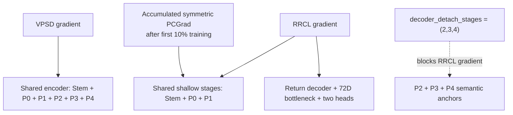

# CVRL-v1m1：与当前代码一致的完整结构

本文档对应当前正式实现：

- `pointspace/models/backbone/cvrl/cvrl_v1m1.py`
- `pointspace/models/backbone/cvrl/common.py`
- `pointspace/models/backbone/litept_v1/litept_v1m4_cvrl.py`
- `pointspace/models/backbone/vpsd/projection.py`
- `pointspace/models/backbone/rrcl/ops.py`
- `configs/cvrl/pretrain-cvrl-v1m1-litept-v1m4-swiss-100.py`

下图描述的是默认 `mode="full"`、LitePT-v1m4、Swiss-100 配置，而不是早期
CVRL 草案。当前模型只有一个共享 LiDAR encoder；视觉与回波监督从共享层级
特征出发，但采用不同的读出路径。

论文版总图（使用配对的真实 Swiss-Audit ALS 与正射影像素材）：

可编辑 SVG、离线 HTML、来源信息与详细图注位于
`paper_cvrl/results/method/figure_1_cvrl_overall_framework.*`；生成脚本为
`paper_cvrl/plot_cvrl_framework_code_aligned.py`。

## 1. 总体结构图

```mermaid
flowchart LR
    subgraph INPUT[Training data and targets]
        P["ALS points<br/>coord + intensity<br/>N x 4"]
        IMG["Orthophoto -> frozen DINOv3<br/>patch teacher T<br/>M x 1024"]
        VIS["Visibility / correspondence<br/>image_valid + patch_index<br/>P_vis only"]
        RET["LAS return metadata<br/>return_number + num_returns<br/>target construction only"]
    end

    subgraph SHARED[One shared LitePT-v1m4 encoder]
        STEM["Stem / embedding<br/>36D"]
        P0["P0<br/>36D, depth 2"]
        P1["P1<br/>72D, depth 2"]
        P2["P2<br/>144D, depth 2"]
        P3["P3<br/>252D, depth 6"]
        P4["P4<br/>504D, depth 2"]
        STEM --> P0 --> P1 --> P2 --> P3 --> P4
    end

    P --> STEM

    subgraph V[VPSD visual branch]
        MAP["Map P3/P4 to P2 hierarchy<br/>aggregate each level to visible patches"]
        CAT["Patch-set feature<br/>144 + 252 + 504 = 900D"]
        PROJ["Native DINO projector<br/>LN(900) -> Linear 1024<br/>GELU -> Linear 1024"]
        COS["Cosine distillation<br/>predicted patch 1024D vs<br/>DINO teacher 1024D"]
        VP["Point visual native feature<br/>uV: 1024D"]
        PCA["Fixed global PCA<br/>L2 norm -> center -> 1024 to 128<br/>L2 norm and scale sqrt(128)"]
        ZV["zV: 128D"]
        MAP --> CAT --> PROJ
        PROJ --> COS
        PROJ --> VP --> PCA --> ZV
    end

    P2 --> MAP
    P3 --> MAP
    P4 --> MAP
    IMG -. teacher target .-> COS
    VIS -. visible patch-token edges .-> MAP

    subgraph R[RRCL return branch]
        DEC["LitePT decoder<br/>P4 -> P3 -> P2 -> P1 -> P0<br/>final point feature 72D"]
        NORM["LayerNorm(72)"]
        ZR["zR: 72D"]
        ROLE["Role head<br/>72 -> 72 -> 4<br/>weighted CE"]
        CTX["Context head<br/>72 -> 72 -> 4<br/>soft CE"]
        RT["Role target<br/>S / F / M / L"]
        KH["Current-set XYZ KNN, K=48<br/>exclude center and invalid roles<br/>4-bin local histogram"]
        DEC --> NORM --> ZR
        ZR --> ROLE
        ZR --> CTX
        RT -. hard target .-> ROLE
        RT --> KH
        KH -. soft target .-> CTX
    end

    P4 --> DEC
    P3 --> DEC
    P2 --> DEC
    P1 --> DEC
    P0 --> DEC
    RET -. build after transforms .-> RT

    ZV --> CONCAT["Concatenate"]
    ZR --> CONCAT
    CONCAT --> ZFULL["zCVRL = [zV | zR]<br/>128 + 72 = 200D"]
    ZFULL --> DOWN["LiDAR-only downstream<br/>linear probe / decoder probe / full fine-tuning"]

    COS --> LV["L_vpsd"]
    ROLE --> LR["L_role"]
    CTX --> LC["L_ctx"]
    LV --> LOSS["L = L_vpsd + lambda_return(t)<br/>x (L_role + lambda_ctx L_ctx)"]
    LR --> LOSS
    LC --> LOSS
```

## 2. 张量路径与维度

| 路径 | 当前实现 | 维度/配置 |
|---|---|---|
| 主干输入 | `coord + intensity`，回波字段不进入 backbone | `N x 4` |
| Encoder | LitePT-v1m4，GridPooling | `P0..P4 = 36, 72, 144, 252, 504` |
| VPSD 层级来源 | 原生 encoder 的 `P2/P3/P4` | `144/252/504D` |
| VPSD patch-set 聚合 | 各层直接按 token-patch edge 聚合到 patch，再拼接 | `144+252+504=900D` |
| Visual native projector | `LayerNorm -> Linear -> GELU -> Linear` | `900 -> 1024 -> 1024` |
| 蒸馏空间 | student patch 与原始 DINO patch cosine loss | `1024D` |
| Visual compact readout | 固定全局 PCA；不参与学习 | `1024 -> 128D` |
| RRCL decoder | LitePT 原生 4-stage decoder | `dec_channels=(72,72,144,252)`，最终 `72D` |
| Role head | `Linear -> GELU -> Dropout -> Linear` | `72 -> 72 -> 4` |
| Context head | 同上 | `72 -> 72 -> 4` |
| KNN context | 当前裁剪/体素采样后的 XYZ 点集，排除中心点 | `K=48`，目标 `N x 4` |
| 最终输出 | `[visual | return]` | `128+72=200D` |

一个容易画错的细节是：训练时不是先把每个 P2 token 投影成 1024D，再聚合到
patch。当前代码先把 P2/P3/P4 各自按 correspondence 聚合到 patch，并在 patch
级拼成 900D，之后才进入 1024D projector。这保持了 VPSD 的
**aggregate-then-project** 顺序。

## 3. 非对称监督与梯度边界

- VPSD 使用 encoder 的 P2/P3/P4，并可更新完整共享 encoder。
- full 模式下，RRCL decoder 仍读取全部层级，但 P2/P3/P4 skip feature 在送入
  decoder clone 时被 `detach`；因此 RRCL 不会直接破坏这三个视觉语义锚点。
- Stem/P0/P1 是两任务真正共享更新的参数。训练前 10% 进行 return warm-up；从
  10% 进度起，`CVRLPCGradTrainer` 在一个完整梯度累积窗口之后，对
  Stem/P0/P1 执行按 stage 的对称 PCGrad。任务私有参数保留普通累计梯度。
- 默认 `gradient_accumulation_steps=4`，PCGrad 不是逐 micro-batch 投影。

## 4. 监督目标与损失

### VPSD

只有具有有效影像 correspondence 的可见点形成 token-patch edges。边权默认为
`sqrt_count`，patch loss 默认按样本平衡。student 与 teacher 都在当前 AMP dtype
下进行 L2 normalization，分块计算 1024D cosine distance：

\[
\mathcal L_{VPSD}=\operatorname{mean}_{j\in\mathcal P_{used}}
\left(1-\langle \bar{\hat t}_j,\bar t_j^{DINO}\rangle\right).
\]

固定 PCA 只负责形成永久 128D 点表示，不承担蒸馏瓶颈；蒸馏仍发生在原生
1024D teacher 空间。

### RRCL

回波角色由 LAS 的 `return_number` 与 `number_of_returns` 构造。无效回波点取
`-1`，保留在 VPSD 与 backbone 中，但同时从 role loss 和 KNN histogram 中
忽略：

\[
\mathcal L_{RRCL}=\mathcal L_{role}+\lambda_{ctx}\mathcal L_{ctx}.
\]

其中 role 使用自动类别权重的交叉熵，context 使用未经类别重加权的 soft-label
cross entropy。

### 总损失

\[
\mathcal L_{CVRL}=\lambda_{VPSD}\mathcal L_{VPSD}+
\lambda_R(t)\left(\mathcal L_{role}+\lambda_{ctx}\mathcal L_{ctx}\right).
\]

当前配置 `lambda_vpsd=1`、`lambda_return_max=1`、`lambda_ctx=1`；
`lambda_R(t)` 在训练最初 10% 从 0 线性升至 1。

## 5. 训练后保留什么

预训练 checkpoint 保存完整 CVRL 网络。用于特征抽取或下游迁移时，可切换：

| `feature_source` / mode | 输出 | 维度 |
|---|---|---:|
| `visual_native` | PCA 前视觉表示，仅用于审计 | 1024 |
| `visual` | 固定 PCA 后的视觉表示 `zV` | 128 |
| `return` | decoder 输出的回波结构表示 `zR` | 72 |
| `full` / `backbone` | `[zV | zR]` | 200 |

下游只需要 LiDAR 点云和 CVRL backbone；orthophoto、DINO patch feature、可见性
correspondence、return target 以及两个 4 类预测 head 都只服务于预训练。若迁移
到普通 LitePT/PTv3 encoder-only 模型，则只能加载兼容的 encoder 参数，不能把
完整 200D CVRL 读出误当成普通单分支 encoder 输出。

## 6. 结构核对结论

当前 CVRL 的核心不是“VPSD 模型与 RRCL 模型并排训练”，而是：

1. 一个共享 LitePT encoder 产生多尺度层级；
2. VPSD 通过受可见性约束的 patch-set 聚合保护并塑造深层语义锚点；
3. RRCL 通过原生 decoder 在全点集学习 72D 点级回波结构；
4. detach 边界和累计 PCGrad 控制共享浅层的任务竞争；
5. 最终永久表示显式保留为 `128D visual + 72D return = 200D`。

这也是后续论文总图必须保持的五个结构事实。
